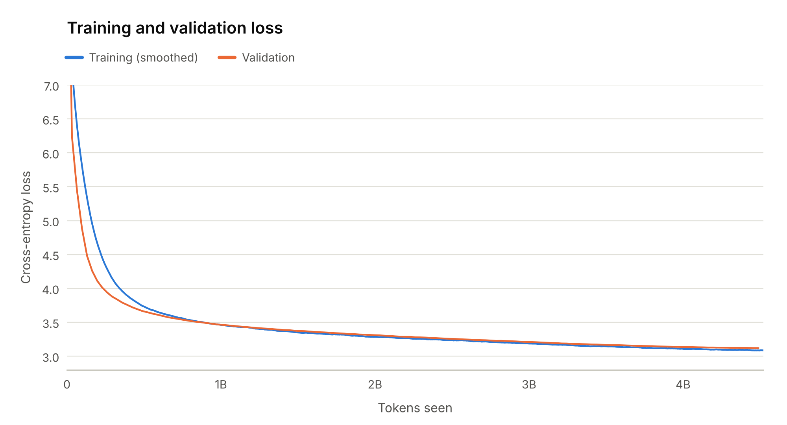
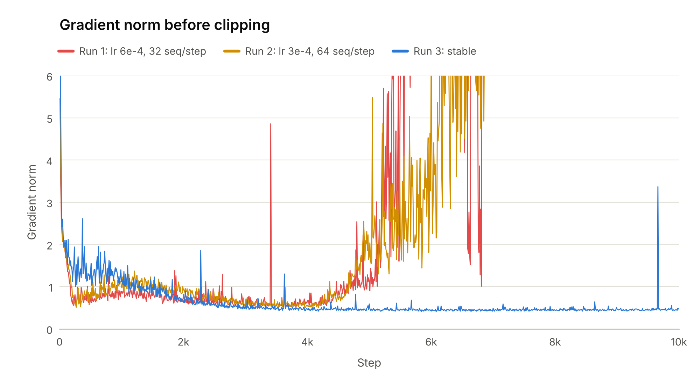
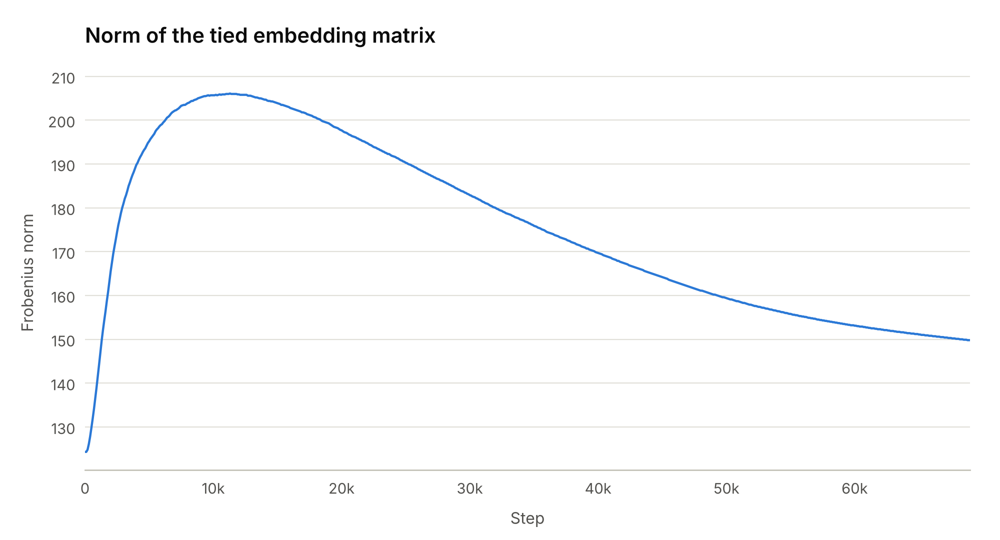

# GPT-style language model from scratch

A 153M-parameter decoder-only transformer, written and trained from scratch in PyTorch.
After 12.5 hours on a single RTX 4090 it reaches a **validation loss of 3.12** (perplexity 22.6)
on OpenWebText.

The repository contains everything needed to reproduce the run: data preparation, model, training
loop with resumable checkpoints, diagnostics and sampling. It is about 1,000 lines of Python and
meant to be read.



## Results

| | |
|---|---|
| Parameters | 152,691,456 (16 layers, 768 dimensions, 8 heads, context 1,024) |
| Data | 4.5B tokens, a 50% subset of OpenWebText, GPT-2 BPE, one pass |
| Hardware | 1× RTX 4090 (24 GB), bfloat16 mixed precision, `torch.compile` |
| Training time | 12.5 hours at about 100,000 tokens per second |
| Final training loss | 3.02 |
| **Final validation loss** | **3.12** (perplexity 22.6) |

Optimiser: AdamW (β₁ 0.9, β₂ 0.95), peak learning rate 3e-4 with 2,000 warm-up steps and cosine
decay to 3e-5, weight decay 0.1, gradient clipping at 1.0, 64 sequences (65,536 tokens) per step,
69,000 steps. The full configuration is in [`config.gpu.yml`](config.gpu.yml).

For orientation: the nanoGPT project reports a validation loss of 3.12 on OpenWebText
for the released GPT-2 small (124M), and about 2.85 for its own reproduction after four
days on eight A100s. GPT-2 itself was trained on a different dataset, this model is
slightly larger, and the validation split here is a different random sample, so the
numbers are only roughly comparable.

Trained weights on huggingface: https://huggingface.co/michaelbabsek/gpt-153m-openwebtext

## Samples over training

Same prompt, same settings (temperature 0.8, top-k 200, seed 42), two checkpoints.
The prompt is in bold.

**Step 5,000, validation loss about 3.83**

> **The history of the Roman Empire**, the Roman Empire, and the Roman Empire had never existed in
> Europe before it was not ruled by the Roman Empire. [...] The Roman Empire was a country of the
> Roman Empire at that time. The Roman Empire was a nation of the Roman Empire at that time. Every
> Roman Empire had its own character, a country of the Roman Empire, a country of the Roman Empire,
> a nation of the Roman Empire [...]

**Step 69,000, validation loss 3.12**

> **The history of the Roman Empire**, the Roman Empire, and the Third World is the most important
> historical document in the world, with its extensive documents on all topics important to the
> reader. As always, I present each document in its entirety, so you may stop at nothing here.
> I hope you enjoy the results. [...]
>
> One of the pillars of the Empire was its invasion of India, which began in the reign of the god
> Zeus, whom the Roman Empire had conquered with great force. Upon its arrival in India, Zeus, who
> was the ruler of the Roman empire, conquered the city of Narsingia.

Early in training the model has grammar and stays on topic, but falls into repetition loops. At the
end it writes varied, structured paragraphs. What it has learned is the form and style of English
web text, not facts: the content is invented.

More samples for all five prompts can be found on huggingface: https://huggingface.co/michaelbabsek/gpt-153m-openwebtext/tree/main/samples

## Training stability

The first two GPU runs did not finish. Both became unstable at a loss of about 4.1, although they
used different learning rates and batch sizes:

| Run | Peak learning rate | Sequences per step | Outcome |
|---|---|---|---|
| 1 | 6e-4 | 32 | loss bottoms out at 4.2, rises from step 5,300 and jumps to 8 at step 6,500 |
| 2 | 3e-4 | 64 | gradient norm climbs from below 1 to above 5 from step 4,500 |
| 3 | 3e-4 | 64 | stable for all 69,000 steps |



Halving the learning rate only delayed the problem, and both runs tipped at the same loss rather
than at the same step. That pointed to the model rather than the schedule. Before run 3 the model
was brought in line with the GPT-2 recipe:

- **Weight decay on the tied embedding matrix.** It had been excluded from weight decay, and the
  decay itself was 0.01 instead of 0.1. This matrix is also the output layer, so nothing limited
  its norm or the size of the logits.
- **Scaled initialisation.** The projections into the residual stream (`attn.proj`, `mlp.fc2`)
  are initialised with std 0.02 / √(2 · n_layers), so that 32 residual contributions do not add up
  to an oversized signal.
- **Attention output projection**, which was missing.

These changes were applied together, so their individual effect was not measured. What the logs
do show: in the stable run the norm of the embedding matrix flattens out after a few thousand
steps, and the gradient norm stays below 1 apart from a few isolated spikes.



Two diagnostics came out of this and are logged at every step next to the gradient norm:
`diag/emb_norm` and `diag/max_abs_logit`. Both tend to rise before a loss spike.

## Model

[`model.py`](model.py), 166 lines.

- Decoder-only transformer with pre-norm blocks: RMSNorm → causal self-attention → RMSNorm → MLP
  (GELU, 4× expansion)
- Learned token and position embeddings; the output layer shares its weights with the token
  embedding
- Attention through `F.scaled_dot_product_attention`, which uses the fused kernel when available
- GPT-2 BPE tokenizer (`tiktoken`) with a few added special tokens; vocabulary padded to 50,304
- No biases, no dropout during pre-training

## Reproducing the run

Requirements: Python 3.10+, PyTorch 2.x, and for the full run a CUDA GPU with 24 GB.

```bash
pip install -r requirements.txt
wandb login                      # or: export WANDB_MODE=offline
```

**1. Prepare the data**

```bash
python dataset.py                # tokenises 50% of OpenWebText into dataset/train.bin and val.bin
python check_data.py             # token counts, largest token id, decoded excerpts
```

The result is a flat `uint16` file with 4.52B tokens (about 9 GB) that is memory-mapped during
training. Batches are drawn from random offsets, so no shuffling pass is needed.

**2. Smoke test on a laptop**

```bash
python train.py --config config.smoke.yml
```

Trains a small 30M-parameter model for 300 steps. This takes a few minutes on Apple Silicon and
checks that the whole pipeline works: the loss should fall from about 10.8 to about 6.5.

**3. Full run**

```bash
python train.py --config config.gpu.yml
```

Run it inside `tmux` on a rented machine. The comments at the top of `config.gpu.yml` explain how
to set `train_iters` after measuring the tokens per second on your hardware.

**4. Sample**

```bash
python sample.py --ckpt checkpoints/gpu/best.pt --temperature 0.8 --top-k 200
```

## Checkpoints and resuming

| File | Written | Purpose |
|---|---|---|
| `best.pt` | when the validation loss improves | the result |
| `last.pt` | every `ckpt_interval` steps and on Ctrl+C | resuming after an interruption |
| `step_005000.pt`, ... | every 5,000 steps, never overwritten | going back in time |

Running the same command again resumes from the newest checkpoint, including optimiser state,
learning-rate schedule, data order and the Weights & Biases run. This was tested by killing the
process with `kill -9` and comparing the continued run step by step with an uninterrupted one.

If a run diverges, go back to a numbered checkpoint and continue with a lower learning rate:

```bash
python train.py --config config.gpu.yml --resume checkpoints/gpu/step_005000.pt --lr-scale 0.5
```

## Repository layout

| File | Content |
|---|---|
| `model.py` | transformer, initialisation, optimiser parameter groups, generation |
| `trainer.py` | training loop, evaluation, logging, diagnostics |
| `train.py` | entry point: config, device, optimiser, schedule, resume |
| `dataset.py` | downloads and tokenises OpenWebText, memory-mapped batch sampling |
| `tokenizer.py` | GPT-2 BPE with added special tokens |
| `checkpoint.py` | atomic saving, loading, compatibility check |
| `sample.py` | text generation from a checkpoint |
| `check_data.py` | sanity checks for the token files |
| `config*.yml` | default, laptop smoke test and GPU run |

## Limitations

- The model is a pre-trained language model only. It continues text; it was not fine-tuned to
  follow instructions or answer questions.
- It saw each token once and only half of OpenWebText. Longer training would lower the loss further.
- Evaluation is validation loss and samples. There is no downstream benchmark.
- The three stability fixes were not ablated individually.

## Acknowledgements

The data preparation follows the approach of Andrej Karpathy's
[nanoGPT](https://github.com/karpathy/nanoGPT). The model, training loop, checkpointing and
diagnostics were written for this project.
